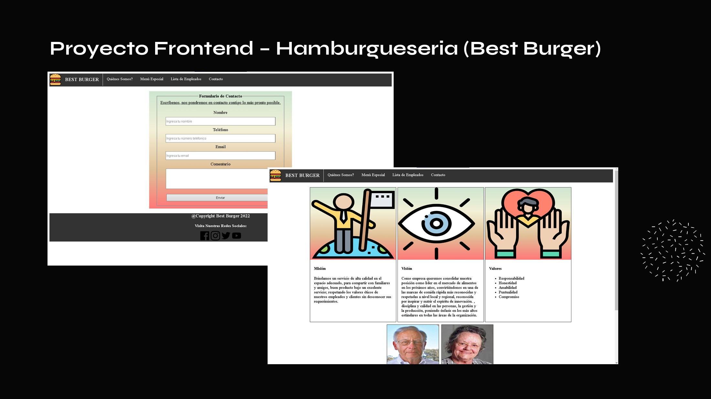
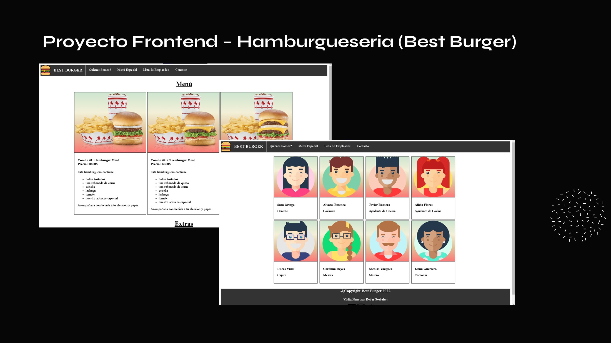

# Best Burger — Sitio Web Frontend

Sitio web estático multipágina para la hamburguesería **Best Burger**, desarrollado con **HTML5** y **CSS3**, que incluye página de inicio, historia institucional, menú especial, listado de empleados y formulario de contacto.

## Vista previa

| Contacto y Quiénes Somos | Menú Especial y Lista de Empleados |
| :---: | :---: |
|  |  |

## Características principales

- **Inicio (`inicio.html`):** Presentación del restaurante, video promocional integrado y galería tipo collage de las instalaciones.
- **Quiénes Somos (`quienes_somos.html`):** Tarjetas informativas de *Misión*, *Visión*, *Valores* y sección de fundadores.
- **Menú Especial (`menu_especial.html`):** Tarjetas de combos con ingredientes y precios, junto a una sección de extras (*Bebidas*, *Papas Fritas* y *Malteadas*).
- **Lista de Empleados (`lista_empleados.html`):** Tarjetas de presentación del personal con avatar y cargo.
- **Contacto (`contacto.html`):** Formulario estático de contacto (*Nombre*, *Teléfono*, *Email* y *Comentario*) y pie de página con redes sociales.

## Tecnologías utilizadas

- **HTML5** (estructura multipágina, tablas y elemento `<video>`)
- **CSS3** (barra de navegación, Flexbox, degradados lineales y estilos de formularios)

## Contexto y estado del proyecto

- **Contexto:** Proyecto frontend estático desarrollado en 2022 con fines académicos.
- **Estado:** Finalizado (maquetación estática archivada para portafolio).

## Autor

**Daniel Alejandro Arita Leiva**
